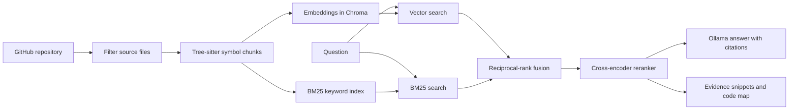

# Codebase Q&A

Codebase Q&A helps a developer build a mental map of an unfamiliar repository, ask questions in plain English, and inspect the code behind each answer. It uses a local Ollama model for answer generation and local embedding and reranking models for retrieval.

## How it works



## Run locally

Requirements: Python 3.13, Git, and [Ollama](https://ollama.com/) running locally. The first model use downloads an embedding model and a reranker; answer generation uses Ollama.

```powershell
py -3.13 -m venv .venv
.\.venv\Scripts\Activate.ps1
pip install -r requirements.txt
ollama pull qwen3:8b
python cli.py index https://github.com/tiangolo/fastapi
python cli.py ask "Where is authentication handled?"
```

Run the combined chat and code map in a browser:

```powershell
streamlit run app.py
```

Paste the repository URL in the sidebar and choose **Index / update repository**. Subsequent indexing refreshes the app-managed shallow checkout and only reprocesses changed files. The code explorer has a visual caller/callee graph, symbol and folder search, one- or two-step neighborhoods, source previews, and a file browser. Dashed graph links are inferred from matching call names, so they may be ambiguous for dynamic dispatch or repeated names. Chat citations link to the repository's `HEAD` lines; retrieved evidence remains visible below each response.

Set `OLLAMA_MODEL` (default `qwen3:8b`) and `OLLAMA_HOST` (default `http://localhost:11434`) to configure the answer model. The embedding model defaults to `sentence-transformers/all-MiniLM-L6-v2`; the reranker defaults to `cross-encoder/ms-marco-MiniLM-L-6-v2`.

## Evaluation

The bundled `eval/test_repo` is a small, deterministic service with authentication, checkout, notification, user, and route flows. `eval/questions.jsonl` has 30 questions with known target file and function labels. Run:

```powershell
python -m eval.run_eval
```

The script compares the four retrieval configurations below using recall@5, recall@10, and MRR. It writes `eval/results/metrics.csv` plus a `manual_review.csv` containing each question's top evidence for all configurations. Add `--generate-answers` to ask the configured Ollama model for candidate answers in the review sheet. Reviewers score answer faithfulness from 1 (unsupported) to 5 (fully supported) after inspecting each answer and its citations. The benchmark script leaves this score as **pending review**; no manual score is claimed before that review is completed.

| Configuration | Retrieval setup |
|---|---|
| Naive fixed-size + vector | Overlapping character windows and semantic search |
| AST + vector | Tree-sitter symbol chunks and semantic search |
| AST + hybrid | AST chunks, vector + BM25, reciprocal-rank fusion |
| AST + hybrid + reranker | Previous setup plus cross-encoder reranking |

Metrics are produced locally for the configured embedding and reranker models, so results should be recorded from the run rather than assumed in advance. The bundled benchmark checks target retrieval; faithfulness scoring separately checks answer quality and citations.

### Air-cargo repository benchmark

The current measured benchmark uses 40 labeled questions against the air-cargo repository at commit `8283e3d1bd400ed99f0b53c20adab3ed2160e9b8`. Run it from the project root (in WSL, activate `.venv` first):

```sh
python -m eval.run_eval \
  --repo data/repositories/e28d70300cdf \
  --questions eval/air_cargo_questions.jsonl \
  --output-dir eval/results/air_cargo
```

To also ask the local Ollama model for 12 answer examples from the strongest retrieval configuration, run:

```sh
python -m eval.run_eval \
  --repo data/repositories/e28d70300cdf \
  --questions eval/air_cargo_questions.jsonl \
  --output-dir eval/results/air_cargo \
  --generate-answers --answer-limit 12 --answer-config "AST + hybrid + reranker"
```

The runner saves retrieval results before optional answer generation, then updates `manual_review.csv` after each generated answer. `run_info.json` records the repository commit and model settings. Qwen reasoning is disabled for these short answer samples to keep its output budget for the answer itself.

Measured retrieval results for this run:

| Configuration | Recall@5 | Recall@10 | MRR |
|---|---:|---:|---:|
| Naive fixed-size + vector | 0.850 | 0.925 | 0.625 |
| AST + vector | 0.825 | 0.925 | 0.627 |
| AST + hybrid | 0.900 | 0.925 | 0.669 |
| AST + hybrid + reranker | **0.900** | **0.950** | **0.720** |

A code-level review of the first 12 Qwen answer samples scored faithfulness at **3.75/5** (8 of 12 scored 4 or 5). Two answers were unrelated to their questions; several other answers were supported but used broad or imprecise citations. This is a small, non-random sample reviewed by the project assistant, not a blinded human study. See [`eval/RESULTS.md`](eval/RESULTS.md) for the shareable summary. Detailed local evidence and answer sheets are written under `eval/results/` and excluded from Git because they contain retrieved source snippets.

These are preliminary, single-repository measurements. Each question has one manually assigned target file and symbol. The Tree-sitter worker also crashed on `agents/mcp_client/agent.py` and `python/generate_all.py` during this run, so those two files used fixed-size fallback chunks even in the AST configurations. The benchmark therefore does not establish general performance across repositories, and AST results should be re-run after the parser crash is resolved.

Run chunking tests with `pytest`.

## Indexing and retrieval details

- Ingestion shallow-clones GitHub repositories and filters common dependency/build directories, lockfiles, unsupported extensions, likely generated/minified files, invalid UTF-8, and files larger than 1 MB.
- Tree-sitter extracts Python and JavaScript/TypeScript functions and methods. Method chunks retain the class signature; imports and docstrings are attached as metadata/context. Large symbols are split by lines with overlap. Other file types use the fixed-size fallback.
- The embedding index and BM25 corpus persist under `data/indexes` for the UI and `data/chroma` for the CLI. File hashes are recorded; changed and deleted files have their previous chunks removed before the index is refreshed.
- Every question requires retrieved code before Ollama is called. Answers are instructed to cite file paths and line ranges and to say “I couldn't find this in the indexed code” when evidence is insufficient.
- The map's call relationships are best-effort static references based on matching call names to indexed symbols; dynamic dispatch and indirect calls may not appear.

## Container deployment

Docker Compose runs the Streamlit app and Ollama with persistent volumes. Start the services, then pull the model into Ollama:

```sh
docker compose up --build -d
docker compose exec ollama ollama pull qwen3:8b
```

Open `http://localhost:8501`. Set `OLLAMA_MODEL` in the environment before starting Compose to choose another Ollama model. The app data is mounted at `./data`; the Ollama model cache uses a named volume. For public deployment, put the app behind an authenticated HTTPS reverse proxy and size the host for the embedding/reranking models and Ollama model.

## Current limits

The UI supports repository map browsing and cited chat. AST parsing currently covers Python and JavaScript/TypeScript, with fixed-size fallback for other extensions. Re-indexing is file-hash based, but the shallow checkout refresh resets the app-managed checkout to the fetched remote head. Retrieval quality and answer faithfulness depend on the selected local models and still need measured review on the target repository.
