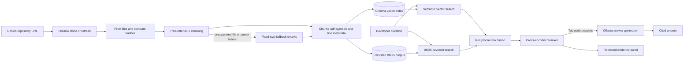
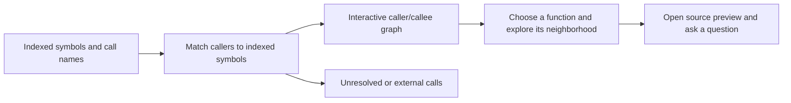

# Codebase Q&A

**Explore an unfamiliar codebase by asking questions in plain English and following the answer back to source code.** Paste a public GitHub repository URL to index it, ask where behavior lives or how a flow works, and inspect the retrieved code, file browser, and caller/callee map.

The app runs locally. Ollama generates answers, while local embedding and reranking models power retrieval. Answers receive file and line citations, and the retrieved snippets remain available for inspection.

**Repository:** [krishx46/codebase-question](https://github.com/krishx46/codebase-question)

## Architecture

### Indexing and question answering



### Code map



The graph uses statically extracted call names. A “possible call” edge is inferred by name matching, so dynamic dispatch, indirect calls, and duplicate function names can make an edge ambiguous.

## Features

- Clone a public GitHub repository and skip common dependency, build, lock, binary, and generated files.
- Split Python and JavaScript/TypeScript source into function, method, and class chunks with file and line metadata. Other supported text files use fixed-size chunks.
- Search code with vector similarity and BM25 keyword retrieval, combine rankings with reciprocal-rank fusion, then rerank the candidates.
- Generate answers from retrieved code using a local Ollama model. The model is not called when retrieval returns no code.
- Show clickable file-and-line citations, retrieved evidence, a source browser, and an interactive code map.
- Re-index changed or deleted files using file hashes. Repository checkouts and index data stay in the local `data/` directory.

## Tech stack

| Part | Technology |
|---|---|
| App and interface | Python 3.13, Streamlit |
| Parsing | Tree-sitter language pack; Python and JavaScript/TypeScript AST extraction |
| Vector index | Chroma |
| Keyword search | BM25 via `rank_bm25` |
| Embeddings | `sentence-transformers/all-MiniLM-L6-v2` |
| Reranker | `cross-encoder/ms-marco-MiniLM-L-6-v2` |
| Answer model | Ollama, default `qwen3:8b` |

## Run locally

Prerequisites: Git, Python 3.13, and Ollama with the `qwen3:8b` model available. On Windows, this project was run from Ubuntu in WSL with Ollama reachable at `http://localhost:11434`.

```bash
cd "/mnt/c/PERSONAL FILES/gen Ai/Codebase_question"
python3.13 -m venv .venv
source .venv/bin/activate
python -m pip install -r requirements.txt
```

Make sure Ollama is running and has the model:

```bash
ollama list
# If needed, pull the model in the Ollama environment:
ollama pull qwen3:8b
```

Start the app:

```bash
export OLLAMA_MODEL=qwen3:8b
export OLLAMA_HOST=http://localhost:11434
streamlit run app.py
```

Open [http://localhost:8501](http://localhost:8501), paste a public GitHub repository URL in the sidebar, and choose **Index / update repository**. To return to an index already stored on this machine, enter the same repository URL and choose **Open existing index**.

The first index or question may download the embedding and reranker model weights. Indexes and cloned repositories are stored locally under `data/` and are excluded from Git.

### Command-line use

The CLI provides a basic index-and-ask flow:

```bash
python cli.py index https://github.com/tiangolo/fastapi
python cli.py ask "Where is authentication handled?"
```

Set `OLLAMA_MODEL` and `OLLAMA_HOST` in the environment to select another local Ollama model or server. The default host is `http://localhost:11434`.

## Evaluation

The benchmark compares four retrieval approaches on labeled questions. Recall measures whether the expected file/function appears within the first *k* results. MRR (mean reciprocal rank) rewards placing the first relevant result near the top. Faithfulness is scored separately by reviewing generated answers and citations.

### Air-cargo repository results

The current run used 40 questions labeled with an expected file and symbol on [`krishx46/air-cargo-analytics`](https://github.com/krishx46/air-cargo-analytics), commit `8283e3d1bd400ed99f0b53c20adab3ed2160e9b8`.

| Retrieval configuration | Recall@5 | Recall@10 | MRR |
|---|---:|---:|---:|
| Fixed-size chunks + vector | 0.850 | 0.925 | 0.625 |
| AST chunks + vector | 0.825 | 0.925 | 0.627 |
| AST chunks + hybrid | 0.900 | 0.925 | 0.669 |
| AST + hybrid + reranker | **0.900** | **0.950** | **0.720** |

On this question set, AST + hybrid + reranking had the highest MRR and Recall@10. Compared with AST + hybrid, reranking raised MRR by 0.051 and Recall@10 by 2.5 percentage points; Recall@5 was unchanged.

A code-level review of 12 generated answers from the best retrieval setup scored faithfulness at **3.75/5**; 8 of 12 scored 4 or 5. Two answers were unrelated to the questions, and several others used broad or imprecise citations. This was a small, non-random sample reviewed by the project assistant, not a blinded human study.

### Reproduce the retrieval run

Clone the evaluated repository and check out the measured revision:

```bash
mkdir -p data/repositories
git clone https://github.com/krishx46/air-cargo-analytics.git data/repositories/air-cargo-analytics
git -C data/repositories/air-cargo-analytics checkout 8283e3d1bd400ed99f0b53c20adab3ed2160e9b8
```

Run the 40-question retrieval comparison:

```bash
python -m eval.run_eval \
  --repo data/repositories/air-cargo-analytics \
  --questions eval/air_cargo_questions.jsonl \
  --output-dir eval/results/air_cargo
```

To generate 12 Qwen answer samples for review, run the same command with these options:

```bash
python -m eval.run_eval \
  --repo data/repositories/air-cargo-analytics \
  --questions eval/air_cargo_questions.jsonl \
  --output-dir eval/results/air_cargo \
  --generate-answers --answer-limit 12 --answer-config "AST + hybrid + reranker"
```

Retrieval results are saved before answer generation, and the local review CSV is updated as each answer completes. Generated review sheets contain retrieved source snippets and remain excluded from Git. The shareable summary is in [`eval/RESULTS.md`](eval/RESULTS.md).

### Evaluation limitations

- The benchmark covers one repository and one manually assigned target symbol per question; it does not establish performance on other codebases.
- The Tree-sitter worker crashed on `agents/mcp_client/agent.py` and `python/generate_all.py` during this run. Those files used fixed-size fallback chunks even in the AST configurations.
- The measured embedding and reranker are general-purpose sentence models, and results depend on these model versions and the question set.
- The answer sample revealed unrelated outputs and citation problems. Answer reliability needs further work and a broader human review.

## Project structure

```text
.
├── answer.py                 # Retrieved-code prompt and Ollama generation
├── app.py                    # Streamlit chat, indexing controls, file browser
├── cli.py                    # Command-line index and ask commands
├── code_graph.py             # Code-map construction and graph UI
├── chunking/
│   ├── ast_chunks.py         # Tree-sitter AST-based chunk creation
│   ├── fixed.py              # Fixed-size chunks and line mapping
│   ├── safe.py               # Isolated parser worker and fallback handling
│   ├── types.py              # Shared code chunk representation
│   └── worker.py             # Child process for native Tree-sitter parsing
├── eval/
│   ├── air_cargo_questions.jsonl # 40 labeled questions for the measured repo
│   ├── questions.jsonl       # 30 questions for the bundled sample repo
│   ├── RESULTS.md            # Shareable evaluation summary
│   ├── run_eval.py           # Retrieval comparison and answer-sample runner
│   └── test_repo/            # Small deterministic evaluation codebase
├── index/
│   └── vector.py             # Chroma index, embeddings, file-hash updates
├── ingest/
│   └── repository.py         # GitHub clone, filtering, and file hashes
├── retrieval/
│   └── hybrid.py             # BM25, reciprocal-rank fusion, reranking
├── tests/
│   └── test_chunking.py      # Chunking unit tests
├── Dockerfile
├── docker-compose.yml
├── requirements.txt
└── README.md
```

## Docker

Docker Compose starts the Streamlit app and Ollama with persistent storage:

```bash
docker compose up --build -d
docker compose exec ollama ollama pull qwen3:8b
```

Then open [http://localhost:8501](http://localhost:8501). Set `OLLAMA_MODEL` before starting Compose to choose another model. The app mounts `./data` for repository and index storage.

## Current scope

The app supports local indexing, chat with retrieved-code citations, and an exploratory code graph. AST extraction currently targets Python and JavaScript/TypeScript; other supported text files fall back to fixed-size chunks. Static call matching can be ambiguous. Retrieval and answer quality depend on the selected models, and answer-faithfulness results remain preliminary.
